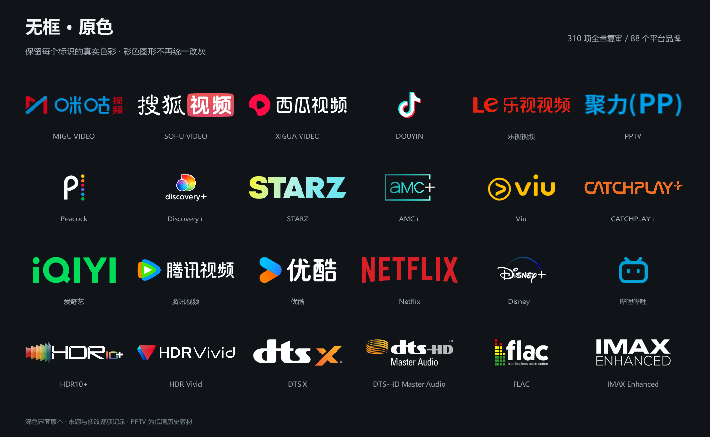

# 映标 · CINE MARKS 无框原色

## 远程订阅

将以下地址填入支持该 `groups` / `filters` 格式的应用：

```text
https://raw.githubusercontent.com/Viceroy-Dennis/cine-marks-noframe/main/badges-noframe.json
```

[查看订阅 JSON](https://raw.githubusercontent.com/Viceroy-Dennis/cine-marks-noframe/main/badges-noframe.json) · [下载整个素材库](https://github.com/Viceroy-Dennis/cine-marks-noframe/archive/refs/heads/main.zip)

订阅地址保持不变。每次发布把图片 URL 锁定到完整的素材提交 SHA，已发布图片不会因后续替换而改变。更新后在使用端刷新订阅即可。GitHub Raw 的缓存与响应头由 GitHub 管理，本仓库不承诺 60 秒刷新；具体刷新速度还取决于客户端缓存和网络。



310 项资源标签，15 个分类。原配置的 ID、名称、正则、分组、排序和启停状态均保持一致，仅修改 imageURL：293 条启用、17 条停用。

这套素材取消了统一灰色及香槟色遮罩。平台标识保留来源中的品牌色、多色组合与渐变；单色字标根据深色资源列表选择白色反白版本，逐项记录变换。没有给所有图标套用同一种颜色。

## 本次复审

- 全部 310 项均已逐张视觉审查，使用深浅背景对照图检查。
- 原包 52 个平台文字占位已替换。
- “来源 / 平台”分组包含 88 个平台品牌和 4 个物理片源标签。88 个平台品牌全部有外部素材来源；不把参考图颜色等同于官方颜色。
- 104 项采用重新取得的素材，包括平台与技术商标。其余 206 项保留参考配色，主要是规格、语言、质量评级和制作组文字，不宣称其为官方品牌标志。
- 恢复彩色细节，例如咪咕红蓝、西瓜粉红、抖音青红、Peacock 六色圆点、STARZ 渐变、HDR10+ 彩虹、HDR Vivid 红蓝、DTS 系列橙黄、FLAC 彩色电平条。
- NHK 官网本身采用灰色，保留其真实灰色；Sony Pictures Core、LINE TV、Viu 等按实际来源分别换成白色、绿白、亮黄色。

## 文件

| 文件 | 用途 |
| --- | --- |
| `index.html` | 可离线搜索、筛选、切换尺寸和下载图标的预览 |
| `preview.png` | 浏览器预览截图 |
| `color-review.png` | 重点平台和技术标识复审展示 |
| `badges/png/` | 310 个 PNG，统一高 96px，建议显示高 24–32px |
| `badges/svg/` | 310 个自包含 SVG；有纯矢量来源，也有内嵌位图 |
| `badges.relative.json` | 相对图片地址配置 |
| `badges-noframe.json` | 固定远程订阅配置；使用绝对 HTTPS 图片地址 |
| `audit-report.md`、`audit.json` | 逐项来源状态、检查结果与限制 |
| `sources.json` | 原始URL、外部素材URL、来源证据与每项变换 |
| `design-prompt.md` | 设计说明与完整可复制提示词 |

## 使用与限制

主要面向深色资源列表。白字标识在浅色背景上会变弱，预览的浅色模式用于检查透明度，并非独立的浅色适配套装。

“无框”指不新增装饰性边框、底座、阴影。少数平台使用官方应用图标，其图标自身的圆角底板、品牌容器或内部渐变保留，例：Bstation、华数TV、Sky Go、KKTV、1905。没有为了透明强行重绘它们。

PPTV 使用可追溯的中国 PPTV 历史“聚力(PP)”标志，源图只有 120×30，仍有清晰度限制。Funimation、Google Play Movies、乐视等使用历史素材，便于识别旧片源，不代表现在仍以同一品牌运营。

SVG 是否为矢量见 `catalog.json` 的 `assetType`。含位图的容器不能保证无限放大无损。部分 SVG 的嵌套位图或颜色适配已通过渲染固定为 PNG，避免终端渲染差异。

原应用导入尚未实测。远程订阅沿用原配置的 groups / filters 结构和 HTTPS PNG。相对地址配置只用于本地或自行托管，不能直接作为远程订阅。

GitHub 版本包含最终 PNG/SVG 和独立构建工具。体积较大的 PNG data URI 内嵌 JSON 不重复提交；需要离线素材时可下载仓库 ZIP。

素材出处逐项记录。乐视 SVG 的 Commons 条目注明 CC-BY-SA 4.0；相关修改及缩放均记录于来源清单，使用该素材时保留来源与同许可要求。其余商标和图标的权利归相应权利人，不宣称本资源包获得官方授权。

## 维护与重新发布

需要 Git 和 Node.js 20 或更新版本，无 npm 依赖。先修改并审核 `badges/png/`、对应 SVG、来源表和相对配置，再提交素材；构建器会检查素材是否与选定提交逐字一致。

```sh
git add badges badges.relative.json catalog.json sources.json audit.json audit-report.md
git commit -m "Update reviewed badge assets"
npm run build:github
git add badges-noframe.json
git commit -m "Publish badge subscription"
git push origin main
```

构建器从 `origin` 读取 GitHub 仓库、从 `HEAD` 读取素材提交，也支持显式参数：

```sh
node scripts/build-github.mjs --repository OWNER/REPO --asset-ref FULL_40_CHARACTER_COMMIT_SHA
npm test
```

只重写 `imageURL`；识别正则、不可见字符、ID、分组、顺序、启用状态和其他字段原样保留。未提交的素材、缺失文件或无效 PNG 会中止构建。发布工具仅生成本地 JSON，`git push` 才会上传到 GitHub。

预览可在解压后直接打开 `index.html`；也可在仓库目录运行 `python -m http.server 8766`，访问 `http://localhost:8766/`。
